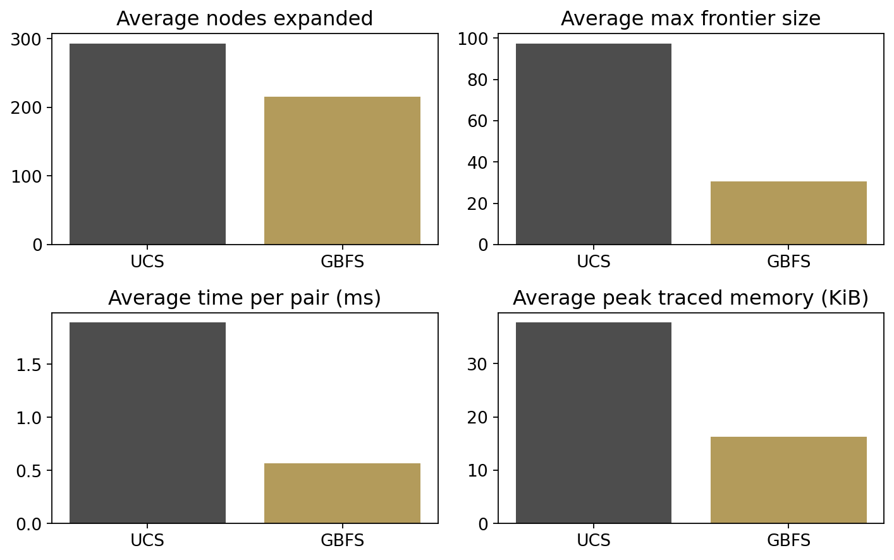
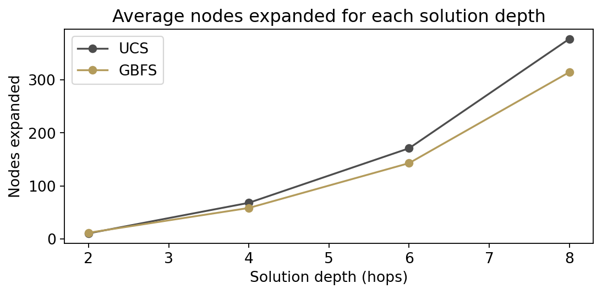

# UCS and GBFS on the US Patent Citation Network

A reproducible comparison of **Uniform Cost Search (UCS)** and **Greedy Best-First Search (GBFS)** for finding directed citation chains in the Stanford SNAP US patent graph. On the 50 recorded reachable tasks, both algorithms returned valid shortest-hop routes. GBFS selected **26.6% fewer states** and used a **68.6% smaller mean maximum frontier**. The depth experiment and weighted example show where that advantage can disappear.

## Quick start

Use **Python 3.12**. Run these commands from the repository root after cloning or extracting the ZIP. Allow several GB of available RAM for the pandas edge list and Python graph.

```bash
python -m venv .venv
source .venv/bin/activate
python -m pip install -r requirements.txt
python -m unittest discover -s tests -v
python -m patent_search --output runs/reproduction
python scripts/verify_reproduction.py runs/reproduction
```

On Windows PowerShell, activate the environment with `.\.venv\Scripts\Activate.ps1`. The installed `patent-search` command also accepts the same options.

The first run downloads the approximately 81 MiB gzip archive into `data/` and extracts the approximately 268 MiB text file. Use an existing copy with `--dataset /path/to/cit-Patents.txt` or pass the gzip file directly. With `--cache path/to/data`, the runner reuses an existing text file or gzip archive in that directory. Each run requires a new output directory.

For the notebook, install `python -m pip install -r requirements-notebook.txt`, launch `jupyter lab` from the root, and open [notebooks/ucs_vs_gbfs.ipynb](notebooks/ucs_vs_gbfs.ipynb). Run all cells for the full benchmark. The notebook shows the archived results before it runs the same package used by the CLI. See [the reproducibility guide](docs/reproducibility.md) for offline setup and verification.

## Objective and dataset

Given two patent IDs, find a directed path from the source to the goal. An edge `A → B` means patent A cites patent B. The objectives are to compare route quality and search effort, verify the returned edges and endpoints, and examine how the numerical heuristic behaves in individual searches.

The SNAP `cit-Patents` file contains **16,518,948** directed citation records. Preprocessing removes one self-loop, retains edges with **both IDs at least 5,000,000**, and checks for duplicate retained edges. The resulting graph has **892,138 states**, **2,709,934 edges**, and **641,971 citing states**. Cited-only states are valid destinations with no successors in the retained graph. The adjacency list preserves file order for repeatable sampling. The release includes a download workflow and checksums. [SNAP dataset](https://snap.stanford.edu/data/cit-Patents.html) · [Recorded provenance](results/recorded/provenance.json)

## Search algorithms

Let $g(n)$ be the cumulative cost of the route to state $n$, and $t$ the goal's numeric patent ID. Each real-data edge costs one, so $g(n)$ is the route's hop count.

| Property | UCS | GBFS |
| --- | --- | --- |
| Evaluation function | $f(n)=g(n)$ | $f(n)=h(n)$ |
| Heuristic | None | `h(n) = abs(n - t)` |
| Reaching a known state | Enqueue a strictly cheaper route, then skip stale entries on selection | Keep the first generated route and mark the state seen |
| Finite graph completeness | Complete with finite nonnegative weights | Complete with finite reachable states and duplicate detection |
| Cost guarantee | Minimum total cost for finite nonnegative weights | First returned route may be longer or more expensive |

Both use the original list frontier and choose the smallest tuple `(priority, patent ID, route)`. The smaller patent ID breaks equal-priority ties. They test the goal when it is selected. Each entry carries its own route, which keeps a later UCS cost improvement paired with the correct predecessors. The validator checks the source, goal, and every directed edge. BFS independently checks the UCS hop count for each main pair.

```text
UCS(start, goal):
    frontier = [(0, start, [start])]
    best_cost = {start: 0}
    explored = empty set
    while frontier is nonempty:
        remove minimum (cost, node, route)
        skip if node is explored
        mark node explored and count it
        if node is goal: return route
        for each directed successor:
            candidate = cost + edge cost
            if the successor is new or candidate is cheaper:
                record candidate and enqueue the extended route
    return no route

GBFS(start, goal):
    frontier = [(h(start), start, [start])]
    seen = {start}
    while frontier is nonempty:
        remove minimum (h, node, route) and count node
        if node is goal: return route
        for each unseen directed successor:
            mark successor seen and enqueue the extended route with h(successor)
    return no route
```

Patent numbers usually decrease along citations. In this filtered graph, **99.9877%** of edges lead to a smaller ID. A small ID gap can still lead to a dead end or a detour. A direct citation can span a large ID gap in a single hop, so this heuristic can overestimate the true distance. [Detailed methodology and complexity](docs/methodology.md)

## Experimental setup

| Experiment | Configuration |
| --- | --- |
| Main comparison | Same 50 distinct, reachable ordered pairs for both algorithms. BFS shortest-distance sampling from 8 to 14 hops, seed 7, up to 100,000 source attempts. |
| Depth sensitivity | Exact shortest distances 2, 4, 6, 8, 10, 12. Request 20 pairs per distance with a separate RNG seeded at 11 and up to 2,000 source attempts per distance. Keep partial and empty samples. |
| Expansion order | Log both algorithms on the first main pair and count shared states, states outside the returned route, and consecutive increases in the heuristic. |
| Timing and memory | Run UCS then GBFS. For each algorithm and pair, warm up once and take the median of five untraced `perf_counter` runs. Measure peak allocation in a separate `tracemalloc` run, after graph construction. |

The expansion counter counts every selected non-stale state, including the goal. Maximum frontier counts entries, including any pending stale entries. Each reported runtime mean averages the per-pair medians. Traced memory describes search allocations in KiB, with the graph prebuilt before tracing.

## Recorded results

| Metric across 50 pairs | UCS | GBFS |
| --- | ---: | ---: |
| Valid routes and successful searches | 50/50 | 50/50 |
| Average path cost and depth (hops) | 8.04 | 8.04 |
| Average selected states | 293.0 | 215.1 |
| Average maximum frontier | 97.4 | 30.6 |
| Average median search time (ms) | 1.892 | 0.567 |
| Average peak traced memory (KiB) | 37.7 | 16.3 |
| Evaluation harness elapsed time (s) | 0.901 | 0.284 |

GBFS matched UCS cost on **50/50** pairs and selected fewer states on **47**, with equal counts on **3**. Forty-eight pairs had shortest depth 8 and two had shortest depth 9. Smaller frontiers give the list-based implementation fewer entries to scan and fewer routes to hold at once. Mean median search time and mean traced memory were **70.0%** and **56.7%** lower, respectively, using unrounded recorded inputs. Harness elapsed time includes repeated runs, tracing, and validation. [All 50 pairs](results/recorded/pair_optimality.csv) · [Recorded comparison](results/recorded/comparison.csv)



### Where the heuristic helps and where it can fail

| Exact shortest depth | Pairs | Attempts | UCS mean selected | GBFS mean selected | GBFS matched UCS |
| ---: | ---: | ---: | ---: | ---: | ---: |
| 2 | 20 | 28 | 10.4 | 11.6 | 100% |
| 4 | 20 | 119 | 68.0 | 58.3 | 100% |
| 6 | 20 | 591 | 170.8 | 142.8 | 100% |
| 8 | 3 | 2,000 | 377.0 | 314.3 | 100% |
| 10 | 0 | 2,000 | N/A | N/A | N/A |
| 12 | 0 | 2,000 | N/A | N/A | N/A |

At depth 2, GBFS selected more states on average. The weighted toy example returns a cost-4 route with UCS and a cost-20 route with GBFS. On real pair 1, both found the same eight-hop path, with **32** UCS selections and **28** GBFS selections. The route includes the increasing-number edge `5191197 → 5509778`. [Depth data](results/recorded/depth_sensitivity.csv) · [Expansion analysis](results/recorded/expansion_analysis.csv)



## Repository map

| Path | Contents |
| --- | --- |
| `src/patent_search/data.py` | SNAP download and cache, edge parsing, graph preprocessing |
| `src/patent_search/search.py` | UCS, GBFS, route validation and counters |
| `src/patent_search/sampling.py` | Seeded sampling and independent BFS distance |
| `src/patent_search/evaluation.py` | Timing, traced allocation, summaries and pair joins |
| `src/patent_search/experiments.py` | Shared CLI and notebook experiment pipeline and CSV exports |
| `src/patent_search/visualization.py` | Figure generation from a fresh run |
| `notebooks/ucs_vs_gbfs.ipynb` | Public notebook, worked examples and reproduction |
| `results/recorded/` | Original CSV values, saved notebook figures, and provenance |
| `results/verification/` | Test log and deterministic reproduction checks |
| `scripts/` | Verification and headless notebook execution |
| `tests/` and `.github/workflows/` | Dataset-free tests and GitHub Actions workflow |
| `docs/` | Methodology, references, reproduction, and consistency audit |

## Reproduction and limitations

The full CLI run and the cleaned notebook were executed against the SNAP edge list. All 50 main and 63 depth-sensitivity pairs matched the archived identities, routes, costs, validity flags, and selection and frontier counts. The expansion sequences and graph statistics also matched. Compare stable fields with the verification script. Compare timing and traced memory only within the same run and environment. [Verification evidence](results/verification/) · [Consistency audit](docs/audit.md)

The sampled tasks are reachable in the filtered graph and the main sample is concentrated at depths 8 and 9. The depth-8 follow-up has three pairs. Depths 10 and 12 yielded no pairs under the source budget, so their metrics are missing. Filtering can remove routes outside the retained patent range, and the ID-gap heuristic depends on dataset structure. Runtime is sensitive to system load, and traced memory measures Python allocations during search.

## Future work

Try depth-balanced sampling and several patent-ID thresholds. Compare heap-backed frontiers and parent pointers in a separate benchmark to quantify implementation effects. A* with $f(n)=g(n)+h(n)$ could balance cost and guidance using a justified admissible heuristic, with consistency or reopening handled explicitly. Use BFS as a unit-cost baseline and evaluate bidirectional search with reverse adjacency. These are proposed experiments.

## References and licensing

The original report's references include Russell and Norvig for search theory, Dijkstra for shortest paths, and Leskovec, Kleinberg, and Faloutsos for the SNAP citation network. [Full references](docs/references.md)

The release proposes MIT for project-owned code and documentation, pending contributor confirmation before public release. The SNAP dataset is a separate resource from Stanford. [MIT license](LICENSE) · [SNAP dataset](https://snap.stanford.edu/data/cit-Patents.html)
